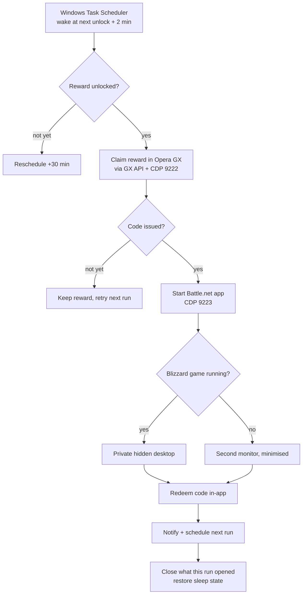

# GX Rewards → Overwatch

**Unattended daily reward claiming for the GX Rewards × Overwatch campaign, with automatic in-app Battle.net code redemption.**

A small, dependency-light Windows automation that wakes your PC at the right moment, claims the next Overwatch reward on [GX Rewards](https://gx.me), redeems the resulting code inside the **Battle.net desktop app**, sends you a phone notification, and then puts everything back the way it was — without ever stealing focus from a game.

[](LICENSE)
[](#requirements)
[](https://nodejs.org)

---

> **Personal use only.** This project automates *your own* account using sessions that are already signed in on *your own* PC. It never asks for, stores, or transmits a password. Automating rewards may violate the terms of service of GX / Opera / Blizzard — use at your own risk. See [Disclaimer](#disclaimer).

---

## Table of contents

- [Why this exists](#why-this-exists)
- [Features](#features)
- [How it works](#how-it-works)
- [Requirements](#requirements)
- [Quick start](#quick-start)
- [Configuration](#configuration)
- [Command-line reference](#command-line-reference)
- [Scheduling & power behavior](#scheduling--power-behavior)
- [Staying out of your way](#staying-out-of-your-way)
- [Files & data](#files--data)
- [Troubleshooting](#troubleshooting)
- [FAQ](#faq)
- [Limitations](#limitations)
- [Security & privacy](#security--privacy)
- [Disclaimer](#disclaimer)
- [License](#license)

---

## Why this exists

The GX Rewards Overwatch campaign releases one reward every 24 hours, and each reward arrives as a Battle.net code that has to be redeemed before the next one unlocks. Doing that by hand every single day for weeks is tedious, and the unlock time drifts because the timer starts when *you* claim.

This project turns that into a fully unattended routine:

- It reads the real unlock time from GX and schedules itself to run **two minutes after** the next reward opens.
- It claims the reward through GX's own API using the session inside **your** Opera GX.
- It types the code into the **Battle.net desktop app**, not a website, so an expired web session can't break the flow.
- It runs silently on a **second monitor** — or on a **hidden desktop** while you're in a game — and closes everything it opened.

---

## Features

| | |
|---|---|
| 🎯 **Exact-time scheduling** | Reads `nextUnlockAt` from GX and moves a single Windows task to that moment + 2 min. One wake per day instead of polling every 30 minutes. |
| 🔁 **Self-rescheduling** | After every run it schedules the next unlock, or retries in 30 minutes if the reward isn't ready yet. |
| 💤 **Wake-to-run, sleep-to-restore** | The task can wake the PC from sleep. If *it* woke the machine and nobody is around, it puts it back to sleep afterwards. |
| 🖥️ **In-app redemption** | Codes are redeemed inside the installed Battle.net app via CDP — no browser session, no password. |
| 🕶️ **Hidden while gaming** | If a Blizzard game is running, the Battle.net app launches on a private Windows desktop: no window, no focus change, no fullscreen drop. |
| 🪟 **Second-monitor UI** | Outside of games, windows open on the secondary monitor (minimised first). On a single-monitor PC they stay minimised. |
| 🔔 **Multi-channel notifications** | ntfy (default, phone push), Telegram, Discord, and a desktop toast — with full UTF-8 support. |
| 🧹 **Clean by design** | Everything the run opened is closed afterwards, unless you're actively using it. A stale session is never left running. |
| 🛡️ **Idempotent & safe to retry** | A ledger tracks every reward and redemption, a lock file prevents overlapping runs, and "already redeemed" is treated as success. |
| ✅ **Auto-stop when done** | When all 24 rewards are claimed, it sends **ALL DONE** and removes its own scheduled task. |

---

## How it works



The launcher chain that keeps the console invisible and off your primary screen:

```
Task Scheduler
  └─ wscript.exe launch-hidden.vbs          (GUI subsystem: no console flash)
       └─ powershell start-console.ps1      (creates the real console hidden)
            └─ run-daily.cmd → node daily.js
                 ├─ Opera GX          (CDP 9222) → claim on api.gx.me
                 ├─ Battle.net app    (CDP 9223) → in-app code redemption
                 └─ notify.js         → ntfy / Telegram / Discord / toast
```

**Key design choices**

- **Real browser, real session.** Opera GX is launched with `--remote-debugging-port=9222` and attached over CDP, so the existing `gx.me` login cookies are reused. Nothing is scraped from a password store.
- **API-level claim.** The claim is a `POST` to GX's `claim-reward` endpoint executed *inside the page context*, so it carries the same cookies and CSRF behavior as the website.
- **In-app redeem, not web.** The Battle.net desktop app stays signed in, so codes are typed into its own “Redeem a code” window over CDP. A custom minimal CDP client is used because Playwright cannot attach to CEF.
- **Hidden desktop for games.** During a match a normal window would activate itself and can drop the game out of fullscreen. `launch-bnet-hidden.ps1` creates a private desktop and starts the app there, so the game keeps the foreground for the entire run.

---

## Requirements

| Requirement | Notes |
|---|---|
| **Windows 10 / 11** | PowerShell 5.1+ (built in). Tested on Windows 11. |
| **Node.js 20+** | LTS recommended — <https://nodejs.org> |
| **Opera GX** | Installed and signed in at <https://gx.me> with the account that has Overwatch linked. |
| **Battle.net desktop app** | Installed from Blizzard and signed in **once** (it stays signed in). |
| **GX account eligible for the campaign** | The campaign must be available to your account; rewards are per-account, max 24. |
| Internet connection | For claiming, redeeming and notifications. |

> The scripts auto-detect Opera GX and Battle.net in their standard install locations, so no paths need editing on a normal install.

---

## Quick start

### 1. Unpack

Extract the folder to a **fixed** location, for example `C:\GX-Rewards`. Don't move it after setup — the scheduled task stores its path.

### 2. Run the installer

Open PowerShell in that folder and run:

```powershell
powershell -ExecutionPolicy Bypass -File .\setup.ps1
```

`setup.ps1` will:

1. Check that Node.js is installed.
2. Locate Opera GX and the Battle.net app (warnings only).
3. Install the single Node dependency (`playwright-core`).
4. Generate a **private ntfy topic** for this PC and write `config.json`.
5. Register the Windows scheduled task.
6. Print the notification topic and the three one-time sign-ins.

It **never touches your account**.

### 3. Sign in once

- **GX:** open Opera GX and sign in at <https://gx.me>.
- **Battle.net:** open the desktop app, sign in, then close it (the script launches it itself).
- **Notifications:** install the **ntfy** app ([Android](https://play.google.com/store/apps/details?id=io.heckel.ntfy) / [iOS](https://apps.apple.com/app/ntfy/id1625396347)), tap **+**, subscribe to the topic printed by setup.

### 4. Test it

```powershell
node daily.js --force
```

You should see the claim and redemption in the console and receive a notification.

That's it — the scheduled task now runs itself at the next unlock time.

---

## Configuration

Settings live in **`config.json`**, created by `setup.ps1` next to the scripts. Notification channels are all optional; ntfy is the default.

```jsonc
{
  "ntfy": {
    "enabled": true,
    "server": "https://ntfy.sh",
    "topic": "gxr-ow-xxxxxxxxxxxxxxxxxxxx",   // generated per PC
    "token": null                              // optional, for protected topics
  },
  "telegram": {
    "enabled": false,
    "botToken": "",
    "chatId": ""
  },
  "discord": {
    "enabled": false,
    "webhookUrl": ""
  }
}
```

| Channel | What you need |
|---|---|
| **ntfy** | The generated topic, subscribed in the ntfy app. Self-host by changing `server`. |
| **Telegram** | Create a bot with [@BotFather](https://t.me/BotFather), get your `chatId`, enable it. |
| **Discord** | Create a webhook in your server settings and paste the URL. |
| **Desktop toast** | Always on — no configuration. |

Test notifications without claiming anything:

```powershell
node notify.js "Test title" "Test message"
# or a non-ASCII test
node notify.js "اختبار" "تم الاتصال بنجاح"
```

> **Important:** `config.json`, `ledger.json` and `logs/` contain private data (your notification topic and your codes). They are listed in `.gitignore` — never commit or share them.

---

## Command-line reference

### `node daily.js`

| Flag | Effect |
|---|---|
| *(none)* | Normal scheduled run. Exits early if the next reward isn't unlocked yet. |
| `--force` | Ignore the unlock timer and run now. |
| `--dry-run` | Claim the reward but **do not** submit the code to Battle.net. |
| `--no-power` | Never put the PC back to sleep. |
| `--keep-open` | Leave every window this run opened (for debugging). |
| `--redeem-only` | Redeem pending codes from the ledger only — does not open Opera GX. |

### `node redeem.js CODE`

Redeem a single code immediately inside the Battle.net app.

```powershell
node redeem.js ABCDE-12345-FGHIJ
```

### `node notify.js "Title" "Message"`

Send a notification on every enabled channel.

### Other entry points

| File | Purpose |
|---|---|
| `setup.ps1` | One-time setup (checks, dependency, config, task). `-RunNow` also runs a first pass. |
| `setup-task.ps1` | (Re)register only the scheduled task. |
| `launch-hidden.vbs` | Registers the console-free launcher used by the task. |
| `start-console.ps1` | Creates the real console on the second monitor without focus theft. |

---

## Scheduling & power behavior

The GX timer is **relative**, not fixed: the next reward unlocks 24 hours after you claim. So the task doesn't run on a wall-clock time — it is moved to the real unlock moment after every run.

| Situation | What happens |
|---|---|
| **Normal** | Task fires at `nextUnlockAt + 2 min`. |
| **Reward not open yet** | Retries in 30 minutes (and re-reads the server time). |
| **PC asleep** | The task has **WakeToRun** and wakes the machine, claims, then sleeps again **only if** it woke the PC and nobody is using it. |
| **PC off** | `StartWhenAvailable` runs the task as soon as Windows boots. Rewards don't expire, so nothing is lost. |
| **User is active** | The PC is never sent to sleep; windows still open off-screen. |
| **A Blizzard game is running** | The PC is never slept, the app uses the hidden desktop, and the game keeps focus. |
| **All 24 claimed** | Sends **ALL DONE** and unregisters the task. |

Useful checks:

```powershell
Get-ScheduledTaskInfo -TaskName "GX Rewards - Overwatch Daily"
Get-ChildItem .\logs\*.log | Sort-Object LastWriteTime | Select-Object -Last 1 | Get-Content -Tail 30
```

Stop the automation permanently:

```powershell
Unregister-ScheduledTask -TaskName "GX Rewards - Overwatch Daily" -Confirm:$false
```

---

## Staying out of your way

This is the part the project spends the most effort on.

| Mechanism | Behavior |
|---|---|
| **Console-less launcher** | The task starts `wscript.exe` (no console), which starts PowerShell hidden, which creates the real console already positioned off-screen. |
| **Second monitor** | Opera GX and Battle.net windows are moved to side-by-side columns on the secondary monitor. |
| **Single monitor** | Every window stays **minimised** — nothing ever appears over your work. |
| **Minimise-first** | Windows are minimised while they boot, then revealed without activation. |
| **Hidden desktop during games** | `launch-bnet-hidden.ps1` creates a private Windows desktop for Battle.net. The app is fully functional and drivable over CDP, but no window exists on any visible desktop. |
| **Never close what you're using** | An app that was already open and is in the foreground is left alone. Only apps the run itself launched are closed. |
| **Game-safe cleanup** | While a Blizzard game runs, Battle.net is only minimised (never killed) and the PC is never slept. |

---

## Files & data

| Path | Tracked in git? | Purpose |
|---|---|---|
| `daily.js` | ✅ | Main workflow: ensure browser → claim → redeem → notify → reschedule → cleanup. |
| `bnet-redeem.js` | ✅ | Drives the Battle.net app's redeem window over CDP. |
| `cdp.js` | ✅ | Minimal dependency-free Chrome DevTools Protocol client. |
| `notify.js` | ✅ | ntfy / Telegram / Discord / desktop toast. |
| `owned.js` | ✅ | Tracks which apps this run launched (so only those get closed). |
| `windows.js` | ✅ | Multi-monitor placement and foreground detection. |
| `*.ps1`, `*.vbs`, `*.cmd` | ✅ | Hidden launch, console placement, task setup, system info. |
| `redeem.js` | ✅ | Manual single-code helper. |
| `ledger.json` | ❌ ignored | Reward + redemption history and codes. **Private.** |
| `config.json` | ❌ ignored | Notification settings and your topic. **Private.** |
| `logs/` | ❌ ignored | One log file per day. **Private.** |
| `run.lock`, `.bnet-hidden` | ❌ ignored | Runtime markers. |

`ledger.json` structure (generated automatically):

```jsonc
{
  "rewards": {
    "<rewardId>": {
      "ordinal": 5,
      "title": "Emre Away",
      "type": "Epic Skin",
      "code": "XXXXX-XXXXX-XXXXX",
      "claimedAt": "2026-11-05T17:36:14.846Z",
      "redeem": { "status": "ok", "message": "Redeemed", "at": "..." }
    }
  },
  "nextUnlockAt": "2026-11-06T14:59:39.656Z",
  "lastCheck": 1793890764437,
  "done": false
}
```

Redeem statuses: `ok`, `already`, `dry-run`, `error`, `unknown`, `login_required`. Only `ok` / `already` are considered final; everything else is retried on the next run.

---

## Troubleshooting

| Symptom | Fix |
|---|---|
| `Node.js is not installed` | Install Node LTS from nodejs.org, reopen PowerShell, rerun `setup.ps1`. |
| `Opera GX not found` | Install Opera GX, or edit the `opera` path in the `CFG` block at the top of `daily.js`. |
| `Battle.net is not installed` | Install the desktop app and sign in once. |
| `Opera GX did not open the debugging port (9222)` | Another Opera instance may be blocking it. Close all Opera windows and rerun. Check that the path in `CFG.opera` is correct. |
| `Battle.net did not open the debug port (9223)` | The app may be mid-update. Open it manually once, sign in, close it, rerun. |
| No notification | Confirm the topic in `config.json` matches the one subscribed in the ntfy app. Run `node notify.js "test" "hello"`. |
| `Battle.net login needed` notification | A code is waiting but the app is signed out. Sign in once; it redeems on the next run. |
| Nothing runs at the scheduled time | `Get-ScheduledTaskInfo -TaskName "GX Rewards - Overwatch Daily"` — check `LastTaskResult` and `NextRunTime`. Confirm “Wake the computer to run this task” is enabled in Task Scheduler. |
| Windows Defender / SmartScreen warns | The scripts are unsigned PowerShell/VBS launchers. Review the source; the project is fully open. |
| First run claimed nothing | The reward gate may not be open yet. Use `--force` and check `logs\` for `not unlocked yet`. |

Logs are your friend: every run appends to `logs\YYYY-MM-DD.log` with UTC timestamps.

---

## FAQ

**Does this store my password?**  
No. It reuses the sessions already present in Opera GX and the Battle.net app. Nothing is read from credential stores and nothing is transmitted anywhere except to GX, Battle.net and your chosen notification channel.

**Do I need Opera GX specifically?**  
Yes for the current build — the script attaches to Opera GX's CDP port and uses its profile. Chrome/Edge could be adapted by changing `CFG.opera`, `CFG.profile` and the launch flags, but that is untested.

**Why redeem inside the app instead of the website?**  
The Battle.net website session expires constantly, while the desktop app stays signed in. The app is also where the account is already authenticated, which makes the flow far more reliable — and it works even while you're playing.

**Will it interrupt my game?**  
No. When a Blizzard game is running, the app launches on a hidden desktop and the game keeps the foreground. The PC is also never sent to sleep during a match.

**What if my PC is off at the scheduled time?**  
The task uses `StartWhenAvailable`, so it runs as soon as Windows starts. Rewards do not expire, so you still get them.

**What if I already claimed today's reward manually?**  
The ledger reconciles with GX on every run and adopts rewards it didn't claim, then redeems any code that hasn't been redeemed.

**Can I run it for a friend?**  
Yes — give them this repository, not your folder. `setup.ps1` generates a separate notification topic, and `ledger.json` / `config.json` start empty for them.

**Does it work on a single monitor?**  
Yes. Windows are kept minimised instead of being moved to a second screen.

**What happens after the campaign ends?**  
After the 24th reward it sends **ALL DONE** and unregisters the scheduled task. You can remove the folder whenever you like.

---

## Limitations

- **Windows only.** The launcher, hidden desktop and task scheduler are Windows-specific.
- **Opera GX + Battle.net desktop app required.** This is a deliberate choice for session reliability, not a browser automation framework.
- **Per-account campaign.** The script can't make an account eligible; if the campaign isn't offered to your account, there is nothing to claim.
- **CDP is an internal interface.** A future Opera or Battle.net update could change its behavior and require a fix.
- **The hidden desktop is best-effort.** It works on standard Windows 10/11 configurations; heavily customised shells or restricted environments may behave differently.
- **No cloud component.** Everything runs locally; there is no server and no telemetry.

---

## Security & privacy

- **No credentials are stored or transmitted.** The tool piggybacks on existing signed-in sessions.
- **Private by default.** `setup.ps1` generates a random ntfy topic per machine; `config.json`, `ledger.json` and `logs/` are git-ignored.
- **Auditable.** ~1,500 lines of plain JavaScript and PowerShell with no obfuscation and a single npm dependency (`playwright-core`).
- **Least privilege.** The scheduled task runs at `Limited` run level as your interactive user.
- **Cleanup.** Apps opened by a run are closed afterwards; runtime markers and the lock file are removed.

If you fork or share this project, **delete `config.json`, `ledger.json` and `logs/` first** — they contain your topic and your codes.

---

## Disclaimer

This project is provided for **personal, educational use**. It automates actions on accounts you own, using software you have installed and signed in to.

- Automating rewards may violate the **Terms of Service** of GX / Opera / Blizzard Entertainment. You are responsible for how you use it.
- It is **not affiliated with, endorsed by, or supported by** GX, Opera, Blizzard, or Overwatch.
- Overwatch, Battle.net and Blizzard are trademarks of Blizzard Entertainment, Inc.
- The authors accept **no liability** for account restrictions, lost rewards, or any other consequences.

If you are unsure whether automation is permitted for your account, **don't use it**.

---

## License

[MIT](LICENSE) © 2026 [abdulaziz-alharbi461](https://github.com/abdulaziz-alharbi461)
